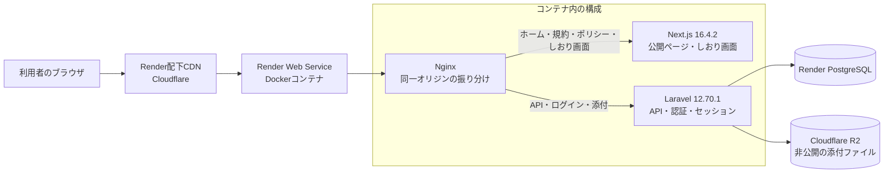
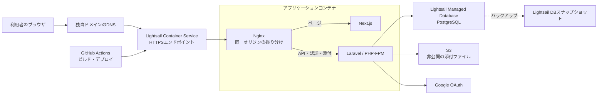

# PLAGINE｜旅のしおり

> **公開一時停止のお知らせ**
>
> PHPの脆弱性が発表されたことを受け、安全性を確認するため、現在Renderでの公開を一時停止しています。

旅の予定、持ち物、お土産、メモをひとつのしおりにまとめ、メンバーと一緒に準備できるWebアプリです。

**公開URL:** [https://guide-2s9j.onrender.com](https://guide-2s9j.onrender.com)

<p align="center">
  
  
  
  
</p>

## 目次

- [PLAGINE｜旅のしおり](#plagine旅のしおり)
  - [目次](#目次)
  - [開発背景](#開発背景)
  - [主な機能](#主な機能)
  - [機能ごとの説明](#機能ごとの説明)
  - [現行アーキテクチャ](#現行アーキテクチャ)
  - [公開アプリの技術構成](#公開アプリの技術構成)
  - [今後の実装方針：Lightsailへ移行](#今後の実装方針lightsailへ移行)
    - [Lightsail移行後のアーキテクチャ案](#lightsail移行後のアーキテクチャ案)

## 開発背景

旅の計画や準備の情報を一か所にまとめ、同行者と共有しながら、旅の前から当日まで使えるしおりを作ることを目指しています。

## 主な機能

- 🗺️ 日付・時刻・場所・写真を使った旅程の作成と並べ替え
- 🎒 個人用の持ち物リストと国内・海外旅行向けテンプレート
- 🎁 メンバーと共有するお土産リスト
- 📝 旅の情報を共有するメモ
- 👥 編集メンバーの招待と共同編集
- 🔗 パスワード付き閲覧リンクの発行
- 📎 JPEG、PNG、PDF、Wordファイルの添付（1ファイル10 MBまで）
- 🔐 Googleアカウントでのログイン

持ち物は利用者ごとに管理し、旅程・お土産・メモはしおりのメンバー間で共有します。

## 機能ごとの説明

各機能の画面を後から掲載できるよう、スクリーンショット欄を用意しています。持ち物リストには公開ページのモックアップを掲載しています。

### 🗺️ 旅程の作成・編集

旅行の日程ごとに予定を追加し、時間・場所・内容・写真をまとめて管理できます。予定はドラッグ操作で並べ替え、メンバーと共有できます。


### 🎒 持ち物リスト

自分専用の持ち物チェックリストを作成できます。国内・海外旅行向けのテンプレートから項目を追加し、準備状況をチェックしたり、順番を並べ替えたりできます。


### 🎁 お土産リスト

買いたいものや購入状況を記録し、旅のメンバーと共有できます。


### 📝 メモ

旅先で確認したい情報や、メンバーに伝えたい内容をしおり内に残せます。


### 👥 メンバーとの共同編集

メンバーを編集者として招待し、旅程・お土産・メモを一緒に更新できます。持ち物リストは利用者ごとに分かれているため、自分の準備状況を管理できます。


### 🔗 閲覧リンクでの共有

閲覧用リンクを発行して、編集権限を持たない相手にも旅のしおりを共有できます。リンクにはパスワードと有効期限を設定でき、必要に応じて停止できます。


### 📎 ファイル添付

予約確認書などの資料をJPEG、PNG、PDF、Word形式で添付できます。1ファイルあたりの上限は10 MBです。


### 🔐 Googleログイン

Googleアカウントでログインして、自分のしおりを作成・編集できます。


## 現行アーキテクチャ



公開URLはRender配下のCloudflare CDNを経由してRenderへ到達します。Renderのデプロイ設定と稼働中のソース構成をもとにしています。NginxはページをNext.jsへ、API・認証・添付の処理をLaravelへ振り分けます。Cloudflare R2は添付ファイルの保存先で、CDNとは別の役割です。

## 公開アプリの技術構成

| 分類 | 技術・構成 | バージョン |
| --- | --- | --- |
| フロントエンド | Next.js、React、TypeScript | 16.4.2、19.3.0、5.9.3 |
| バックエンド | Laravel、PHP | 12.70.1、8.3.36 |
| Webサーバー | Nginx | Render用Dockerイメージに同梱 |
| データベース | PostgreSQL | Renderマネージドデータベース |
| 添付ファイル | Cloudflare R2 | 非公開バケット |
| ホスティング・エッジ | Render、Cloudflare | Web Service・エッジ配信 |

## 今後の実装方針：Lightsailへ移行

Next.jsとLaravelを含むアプリケーションをコンテナ化してLightsail Container Serviceで配信する案です。旅程などの永続データはLightsailのmanaged PostgreSQLへ、添付ファイルはコンテナ外の非公開S3バケットへ保存します。

### Lightsail移行後のアーキテクチャ案



## ローカルでNext.jsアプリを起動する

画面はNext.js、API・認証・セッションはLaravelが担当します。`docker-compose.yml` にLaravel、Next.js、Nginx gatewayの各サービスがあります。gatewayを入口にすると、ブラウザーからは同一originのまま、画面をNext.jsへ、APIなどをLaravelへ振り分けます。

事前に `.env` を用意し、`composer install` でLaravelの依存関係を準備してください。E2Eを実行する場合はNode.js 22.23.4以上とフロントエンドの依存関係も必要です。Next.jsのDocker image build時にフロントエンドの依存関係とproduction buildを作成します。

```sh
docker compose up -d laravel.test
./vendor/bin/sail artisan migrate
docker compose up --build -d next next-gateway
```

アプリは `http://localhost:8081`（`NEXT_GATEWAY_PORT` で変更可能）で開きます。別のportを使う場合は `.env` の `NEXT_GATEWAY_PORT`（数値）と `NEXT_PUBLIC_ORIGIN`（origin URL）を一致させます。たとえば `NEXT_GATEWAY_PORT=8082`、`NEXT_PUBLIC_ORIGIN=http://localhost:8082` とします。`NEXT_PUBLIC_ORIGIN` はNext.jsのmetadata用URLとしてbuild時に使われるため、変更後は `docker compose up --build -d next next-gateway` でNext.js imageを再buildしてください。Google OAuthを使う場合はcallback URLもgatewayの公開URLに合わせます。

gatewayは `/api/`、`/sanctum/`、`/auth/`、`/login`、`/logout`、`/register`、`/up`、`/storage/` をLaravelへ送り、`/_next/`、`/images/` とそれ以外の画面URLをNext.jsへ送ります。Livewire/Blade画面やVite画面へフォールバックする構成ではありません。この同一origin経路では、ブラウザーがLaravelのセッションCookieとCSRF Cookieを同じoriginへ送れます。

しおり一覧・作成・編集・共有画面はSSRで初回データを取得し、React Queryへ引き継ぎます。ログイン確認とAPI取得には受信したセッションCookieを使い、`cache: "no-store"` でユーザー間の共有キャッシュを避けます。編集・保存・共有パスワードの送信は従来どおりブラウザーからAPIへ送ります。トップ・規約ページは静的生成を維持します。Next.jsサーバーからLaravelへ接続するoriginはサーバー専用の `API_INTERNAL_ORIGIN` で指定します（Docker Composeでは `http://laravel.test`、Renderコンテナでは `http://127.0.0.1:10000`）。未指定時は `NEXT_PUBLIC_SITE_URL`、それも未指定なら `http://localhost:8081` を使います。ホストでNext.jsを単独起動する場合は、LaravelのURL（例: `http://127.0.0.1:8000`）を指定してください。

Next.jsアプリを停止する場合はNext.jsとgatewayを停止します。停止後、gateway経由の画面は利用できません（Laravel画面へ自動で切り替わる構成ではありません）。

```sh
docker compose stop next-gateway next
```

LaravelのAPIやDBは別サービスとして動作します。gatewayの停止自体はDBやLaravelの保存データを変更しません。

実ブラウザーでのE2Eには、Composer依存関係とフロントエンドのnpm依存関係を用意し、Chromiumをインストールした後に `npm run e2e:next` を実行します。このコマンドは専用の `database/e2e.sqlite` を作り、owner/member/guestのテスト記録とセッションfixtureをCLIで準備します。通常の `.env` に書かれたDB接続先は使わず、PHP・Next.js・同一origin gatewayをローカルで起動して、検証後に停止します。OAuth callbackを偽装するHTTPルートは追加しません。

```sh
npm --prefix frontend run e2e:install
npm run e2e:next
```

API の HTTP E2E と Playwright のブラウザ E2E は別々に出力されます。スクリーンショットは `/tmp/guide-next-e2e/` に保存されます。

## Renderの構成

Renderでは `Dockerfile.render-next` がLaravelとNext.js standaloneを1つのコンテナにまとめ、Nginxが単一originでリクエストを振り分けます。`/api/`、`/sanctum/`、`/auth/`、`/login`、`/logout`、`/register`、`/up` はLaravelへ、`/_next/`、`/images/` とそれ以外の画面URLはNext.jsへ届きます。つまり、Renderでもユーザー向けの画面はNext.jsが担当し、Laravel画面へフォールバックしません。

起動時に `php artisan migrate --force` を実行します。デプロイ前に新しいmigrationとDB backupを確認してください。Renderのbranch・環境変数・DBの期限・OAuth設定などの運用状況や、確認済み/未確認の本番操作は変わるため、[実装状況](docs/NEXT_TYPESCRIPT_IMPLEMENTATION_STATUS.md)を参照してください。秘密情報はRenderのruntime環境変数で管理し、ソースやNext.js buildへ含めないでください。

添付の保存先は `FILESYSTEM_UPLOADS_DISK` で選びます。Renderではprivate R2 bucketを使い、ブラウザーからは認可済みのLaravel endpointを通して取得します。R2資格情報はサーバー側のruntime環境変数で管理し、Next.jsクライアントコードやブラウザーへ公開しません。AWS S3の設定とは別です。添付レコードには保存先disk名を記録し、disk名がない既存レコードは `FILESYSTEM_LEGACY_UPLOADS_DISK` で指定した従来diskから読み書き・削除します。既存ファイルの移動やbackfillは自動実行しません。

## ランタイムのセキュリティ更新

本番・開発・CIで修正済みNode.js/PHPを使用し、古いバージョンではインストール・ビルド・起動を失敗させます。[対象バージョン・検証方法・残る開発用依存の警告](docs/RUNTIME_SECURITY.md)を参照してください。公開一時停止は、修正版の本番反映と確認が済むまで継続します。
